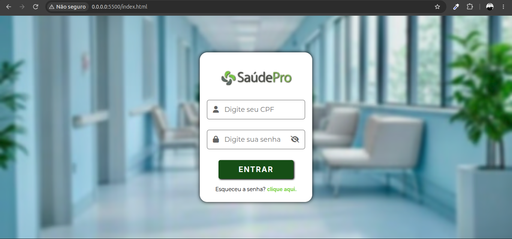
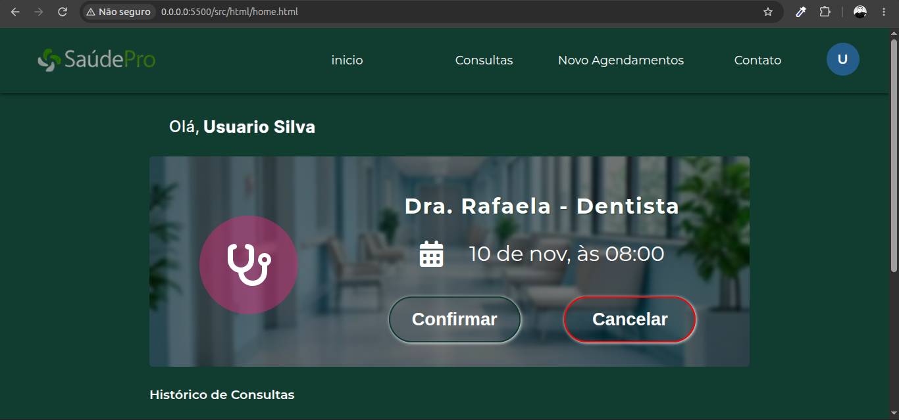
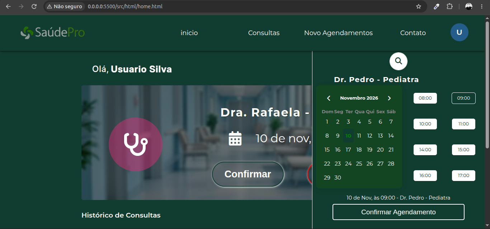
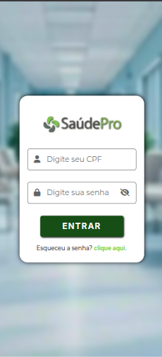
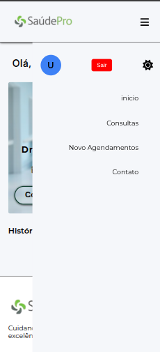
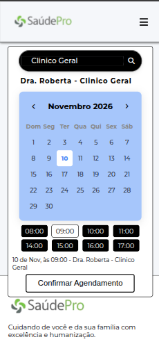

# 🏥 SaúdePro - Portal do Paciente (Web)

> Sistema web front-end para gestão de agendamentos de uma clínica médica. Desenvolvido como evolução do sistema Desktop (Java Swing), este portal permite que o paciente consulte, confirme, cancele e agende novas consultas de forma autônoma e responsiva.

## 📸 Preview do Projeto

### Tela de Login


### Área do Paciente (Desktop)



### Versão Mobile
<p align="center">
  
  
  
  
</p>

## 📋 Sobre o Projeto

Este projeto foi desenvolvido para a **Etapa 8** do curso Técnico em Desenvolvimento de Sistemas — Projeto Integrado (PI). O objetivo principal é criar a interface web (front-end) que consome dados simulados (via JSON Server) de médicos, pacientes e consultas, preparando toda a arquitetura para receber o back-end real em Java (Spring Boot / Tomcat) na próxima etapa.

### ✨ Funcionalidades Principais

- **Autenticação Simulada:** Login via CPF e senha (validando contra o banco simulado), armazenando a sessão do usuário no `sessionStorage`.
- **Recuperação de Senha:** Simulação de envio de e-mail com geração de senha provisória via JavaScript.
- **Dashboard do Paciente:** Exibição da próxima consulta aberta com opções de Confirmar ou Cancelar.
- **Histórico de Consultas:** Lista dinâmica de todas as consultas passadas (Confirmadas, Canceladas ou Concluídas).
- **Novo Agendamento (SPA):** Painel lateral interativo com busca de médicos por nome/especialidade, calendário dinâmico e seleção de horários disponíveis.
- **Regras de Negócio (Front-end):** 
  - Bloqueio de agendamentos em finais de semana e datas passadas.
  - Verificação de conflito (o paciente não pode ter duas consultas no mesmo dia/hora).
  - Ao cancelar uma consulta, o horário é liberado automaticamente na agenda do médico.
- **UI/UX Avançado:** Tema Dark/Light persistente, efeito Skeleton Loading durante as requisições, animações suaves e layout 100% responsivo (Mobile First).

## 🛠️ Tecnologias e Ferramentas

- **HTML5 / CSS3:** Estrutura semântica, Grid Layout, Flexbox, variáveis CSS, animações e media queries.
- **JavaScript (ES6+):** Modularização (ES Modules), `async/await`, `fetch API`, manipulação de datas com `Intl`.
- **JSON Server:** Simulador de API RESTful (hospedado localmente na porta 3000).
- **Font Awesome 6 (CDN):** Ícones.
- **Google Fonts:** Montserrat e Inter.
- **Git:** Versionamento com Conventional Commits.
- **Figma:** Criação dos Wireframes.

## 📁 Estrutura do Projeto

A arquitetura do projeto foi pensada para ser limpa, escalável e de fácil manutenção:

```text
SaudePro-Web/
├── 📁 src
│   ├── 📁 assets
│   │   ├── 📁 favicon
│   │   │   └── 📄 favicon.ico             # Ícone da aba do navegador
│   │   └── 📁 img
│   │       ├── 📄 background-saude-pro.avif # Imagem de fundo (Login e Área do Paciente)
│   │       └── 🖼️ saude-pro-logo.png       # Logotipo oficial do SaúdePro
│   ├── 📁 css
│   │   ├── 🎨 footer-home.css             # Estilos do rodapé institucional
│   │   ├── 🎨 global.css                  # Reset, variáveis (Light/Dark) e hack de Autofill
│   │   ├── 🎨 header-home.css             # Estilos do menu superior e navegação
│   │   ├── 🎨 home.css                    # Importações e estilos base da Home
│   │   ├── 🎨 index.css                   # Arquivo mestre que importa todos os módulos CSS
│   │   ├── 🎨 login.css                   # Estilos exclusivos das telas de Login e Recuperação
│   │   ├── 🎨 main-home.css               # Estilos do Dashboard, calendário e painel de agendamento
│   │   └── 🎨 utils.css                   # Classes utilitárias (botões, loaders, skeleton, emojis)
│   ├── 📁 html
│   │   └── 🌐 home.html                   # Página principal (SPA) onde o paciente gerencia tudo
│   └── 📁 js
│       ├── 📄 data.js                     # Comunicação com a API (fetch GET, POST, PUT, DELETE)
│       ├── 📄 elementsDom.js              # Mapeamento centralizado de todos os elementos HTML
│       ├── 📄 headerHome.js               # Lógica do menu mobile, Dark Mode e Logout
│       ├── 📄 home.js                     # Saudação ao usuário, controle de sessão e scroll
│       ├── 📄 index.js                    # Ponto de entrada que aguarda o DOMContentLoaded
│       ├── 📄 init.js                     # Orquestrador que inicializa os módulos do sistema
│       ├── 📄 login.js                    # Lógica de validação, máscara e recuperação de senha
│       ├── 📄 mainHome.js                 # Regras do calendário, agendamento e histórico
│       └── 📄 utils.js                    # Funções puras (máscaras, formatar data, limpar HTML)
├── 📁 telas-imgs                          # Prints das telas finais do sistema (Preview)
│   ├── 🖼️ 1-login-desktop.png              # Print da tela de Login (Desktop)
│   ├── 🖼️ 2-home-consulta-inicio-desktop.png # Print do Dashboard (Desktop)
│   ├── 🖼️ 3-home-consulta-agendamento-desktop.png # Print do Agendamento (Desktop)
│   ├── 🖼️ 4-login-user-mobile.png        # Print do Login (Mobile)
│   ├── 🖼️ 5-login-user-Inicio-mobile.png   # Print do Dashboard (Mobile)
│   ├── 🖼️ 6-login-user-menu-mobile.png     # Print do Menu Mobile aberto
│   └── 🖼️ 7-login-user-agendameno-mobile.png # Print do Agendamento (Mobile)
├── 📁 wireframe                           # Protótipos de baixa/média fidelidade (Atividade 8)
│   ├── 📁 TELA DE CONSULTA
│   │   ├── 🖼️ 1 - consulta - 1° wireframe - inicio.png          # Wireframe Desktop (Início)
│   │   ├── 🖼️ 2 - consulta- 1° wireframe - agendamento.png      # Wireframe Desktop (Agendamento)
│   │   ├── 🖼️ 3 - login-user-mobile - 1° wireframe - Inicio.png  # Wireframe Mobile (Início)
│   │   ├── 🖼️ 4 - login-user-mobile - 1° wireframe - menu.png    # Wireframe Mobile (Menu)
│   │   └── 🖼️ 5 -login-user-mobile - 1° wireframe - agendameno.png # Wireframe Mobile (Agendamento)
│   └── 📁 TELA DE LOGIN
│       ├── 🖼️ Login-User - 1° Wireframes.png                    # Wireframe Desktop (Login)
│       └── 🖼️ Login-User-mobile - 1° Wireframes.png             # Wireframe Mobile (Login)
├── ⚙️ .gitignore                          # Arquivos ignorados pelo Git (node_modules, etc)
├── ⚙️ db_simulator.json                   # Banco de dados simulado (JSON Server)
├── 🌐 index.html                          # Página inicial (Tela de Login)
├── ⚙️ json-server.json                    # Configurações do JSON Server (porta, cors, etc)
├── ⚙️ package-lock.json                   # Histórico exato das dependências
├── ⚙️ package.json                        # Dependências do projeto (json-server)
└── 📝 readme.md                           # Documentação do projeto
```

## 🚀 Como Executar o Projeto

Como o projeto utiliza **ES Modules** e consome uma API local, você precisa rodar dois servidores (o do banco e o do site).

### 1. Iniciar o JSON Server (Banco de Dados)
No terminal, na raiz do projeto, instale as dependências e inicie o servidor:
```bash
npm install
npx json-server --watch db_simulator.json --port 3000
```
*(O banco estará rodando em `http://localhost:3000`)*

### 2. Iniciar a Aplicação Web
Como o projeto usa `type="module"`, ele precisa ser servido por um servidor HTTP.
- Utilizando a extensão **Live Server** no VS Code: Abra o `index.html` e clique em "Open with Live Server".
- Ou via terminal com Python: `python -m http.server 5500` (na raiz do projeto).

### 3. Login para Testes
Use os dados presentes no `db_simulator.json`:
- **CPF:** `12345678910`
- **Senha:** `2468`

## 🧠 Decisões Arquiteturais e Aprendizados

1. **Autenticação por CPF:** Como o modelo Java (`Paciente.java`) não possui campo de senha originalmente, adotou-se o CPF como senha inicial. O front-end simula essa lógica e já prevê um fluxo de "Primeiro Acesso".
2. **Skeleton Loading:** Implementado via CSS puro enquanto o `fetch` resolve, melhorando drasticamente a percepção de velocidade (UX).
3. **Tratamento de Fuso Horário:** O JavaScript sofre com o "pulo" de dias ao usar `toISOString()`. Criou-se a função `formatarParaDataDB` para garantir que a data seja montada manualmente no padrão `YYYY-MM-DD` local, sem subtrair dias.
4. **Modularização (ES6):** A separação entre `data.js` (requisições), `elementsDom.js` (DOM) e `mainHome.js` (lógica) deixa o código pronto para a **Etapa 9**, onde apenas a URL do `fetch` será trocada de `localhost:3000` para a API Java.

## 🔄 Próximas Evoluções (Etapa 9 - Back-end)

- [ ] Substituir as rotas do JSON Server pelas rotas da API REST Java (Spring Boot).
- [ ] Implementar criptografia de senha no banco real (BCrypt).
- [ ] Criar tela de "Primeiro Acesso" para forçar a troca da senha inicial (CPF).
- [ ] Implementar envio de e-mail real (SMTP) para a recuperação de senha.

## 👤 Autor

**Bruno Teixeira**
- GitHub: [@brunotxrs](https://github.com/brunotxrs)

---
*Projeto acadêmico desenvolvido para o Senac EAD — Projeto Integrado (PI)*